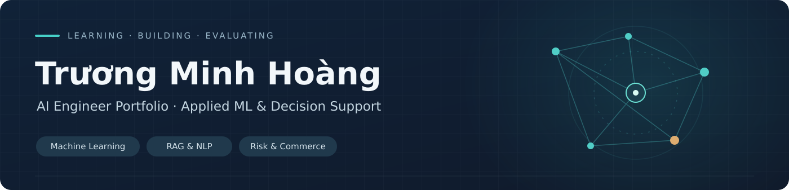

# Applied AI Portfolio / Hồ sơ dự án AI

[English](#english) · [Tiếng Việt](#tiếng-việt) · [Projects / Dự án](#projects--dự-án) · [Learning Labs](labs/README.md)

## English

I'm Trương Minh Hoàng, an Artificial Intelligence student at the University of Information Technology (VNU-HCM), with a background in e-commerce, digital advertising, product sourcing, and business operations.

I enjoy working from a real problem toward an implementable solution: understanding the decision, preparing data, choosing a simple baseline, developing a model or system, then evaluating its behavior and finding where it needs improvement.

My work covers **machine learning for structured data, Vietnamese NLP, computer vision, retrieval-augmented generation (RAG), financial time-series research, and decision-support systems**. I also bring commercial experience in marketplaces, supplier negotiation and performance-oriented marketing.

I use this GitHub portfolio to explain my projects in both English and Vietnamese. Each case covers the **context, problem, input, output, approach, practical constraints, results, lessons and next steps**.

## Tiếng Việt

Tôi là **Trương Minh Hoàng**, học ngành Trí tuệ nhân tạo tại Trường Đại học Công nghệ Thông tin (ĐHQG TP.HCM). Trước và trong quá trình học AI, tôi có kinh nghiệm làm thương mại điện tử, quảng cáo, nghiên cứu sản phẩm, tìm nguồn hàng và vận hành kinh doanh.

Tôi quan tâm đến việc **đưa AI vào những bài toán có ý nghĩa thực tế**. Khi làm một dự án, tôi bắt đầu từ bối cảnh và yêu cầu đầu ra, tìm hiểu dữ liệu và các ràng buộc, thử phương án đơn giản làm đối chứng, phát triển giải pháp, kiểm tra kết quả rồi tiếp tục cải tiến.

Những hướng tôi đã thực hành gồm **Machine Learning, NLP tiếng Việt, Computer Vision, RAG, dữ liệu chuỗi thời gian và hệ thống hỗ trợ quyết định**. Tôi cũng đang củng cố Python, SQL, API engineering và cách triển khai, theo dõi ứng dụng AI.

Portfolio này tập hợp cả **đồ án môn học, dự án ứng dụng, bài thực hành Colab và các tình huống kinh doanh thực tế**. Tôi trình bày hai ngôn ngữ để người xem hiểu tôi đã tiếp cận và giải quyết từng vấn đề như thế nào.

## Projects / Dự án

| Dự án / Project | Nội dung / Focus | Hồ sơ và mã / Case & code |
| --- | --- | --- |
| **Graph-Assisted Shared Risk Context — KLTN** | Đặc trưng đồ thị, AP/Top-1% và chuẩn hóa đầu ra rủi ro | [VI / EN](projects/graph-assisted-shared-risk-context/README.md) |
| **Credit Risk Modeling** | Logistic Regression/LightGBM, xác suất rủi ro và feature availability | [VI / EN](projects/credit-risk-modeling/README.md) |
| **SNJ Hybrid RAG Jewelry Advisor** | Intent, lọc thuộc tính và tìm sản phẩm bằng dense/TF-IDF/rules | [VI / EN](projects/snj-hybrid-rag-jewelry-advisor/README.md) |
| **Intelligent Commerce Chatbot** | Tư vấn mua hàng nhiều lượt, bộ nhớ phiên và điều phối công cụ | [VI / EN](projects/intelligent-commerce-chatbot/README.md) |
| **RegimeLens — Market Regimes** | HMM, dự đoán trạng thái thị trường và đánh giá theo thời gian | [VI / EN](projects/regimelens-market-regimes/README.md) |
| **Multimodal Traffic-Law QA** | Tra cứu luật theo nguồn và hướng kết hợp ảnh biển báo | [VI / EN](projects/traffic-law-multimodal-qa/README.md) |
| **PAR Decision-Support UI** | Luồng hỗ trợ quyết định, async state và độ tin cậy giao diện | [VI / EN](projects/par-decision-support/README.md) |
| **Wine Quality — Classification & Regression** | Phân loại/hồi quy UCI, grouped cross-validation và đối chứng | [VI / EN](projects/wine-quality-prediction/README.md) |
| **Multi-Camera Face Attendance** | YOLO/ArcFace, camera RTSP, FastAPI/SQLite và điểm danh PC/LAN | [VI / EN](projects/multi-camera-face-attendance/README.md) |
| **Business Problem Solving** | Tranh chấp SaaS, B2B sourcing và kinh nghiệm marketplace/ads | [VI / EN](projects/business-problem-solving/README.md) |

[**Xem toàn bộ danh mục, trạng thái chạy và phần còn mở / Full project index and validation scope**](projects/README.md) · [**Tên file cũ → mới / File map**](projects/FILE_MAP.md)

## Learning journey / Quá trình học

Tôi lưu lại cả bài tập cơ bản và những thử nghiệm nhỏ trên Google Colab: Python, đại số tuyến tính, PCA, phân cụm, ML cổ điển, mạng nơ-ron, NLP và bài toán thương mại điện tử. Các bài này giúp thấy quá trình học từ khái niệm đến ứng dụng, bên cạnh những đồ án lớn hơn.

- [AI Learning Labs / Nhật ký thực hành](labs/README.md) — **7/7 notebook đã chạy từ đầu**, có output, biểu đồ và hướng dẫn tái lập. [Kết quả chạy](labs/EXECUTION_REPORT.md).
- [Colab archive / Kho bài tập mở rộng](labs/archive/README.md) — 35 notebook bổ sung; ghi riêng bài đã chạy và bài còn phụ thuộc môi trường/dữ liệu.
- [Technical review notes / Ghi chú rà soát nguồn](labs/REVIEW_QUEUE.md) — đối chiếu các phiên bản Colab, bài còn lỗi và hướng tái lập.
- [Interview practice / Câu hỏi đào sâu song ngữ](INTERVIEW_DRILL.md) — cách tôi ôn lại cơ sở thuật toán, thiết kế và đánh giá từng hệ thống.
- [Project evidence & technical notes / Tài liệu đối chiếu](EVIDENCE_REGISTER.md) — nguồn tài liệu và trạng thái kiểm tra chi tiết.

## What I'm working on / Hướng đang phát triển

1. Mở rộng kho thực hành từ bảy notebook đã chạy đầy đủ; tiếp tục chọn lọc và tái lập các bài Colab còn lại.
2. Đào sâu **Python, SQL, Machine Learning và AI Engineering**, đặc biệt cách tránh sai lệch khi xử lý dữ liệu và đánh giá mô hình.
3. Phát triển **AI cho thương mại điện tử**, kết nối catalog, ngôn ngữ tự nhiên, hành vi mua hàng và hỗ trợ quyết định.
4. Thực hành API, Docker, cloud deployment, kiểm thử và giám sát trên các dự án phù hợp.
5. Rèn khả năng trình bày thiết kế, kết quả và đánh đổi kỹ thuật bằng **tiếng Việt và tiếng Anh**.

---

*Portfolio cá nhân của Trương Minh Hoàng · Cập nhật 25/10/2026.*

