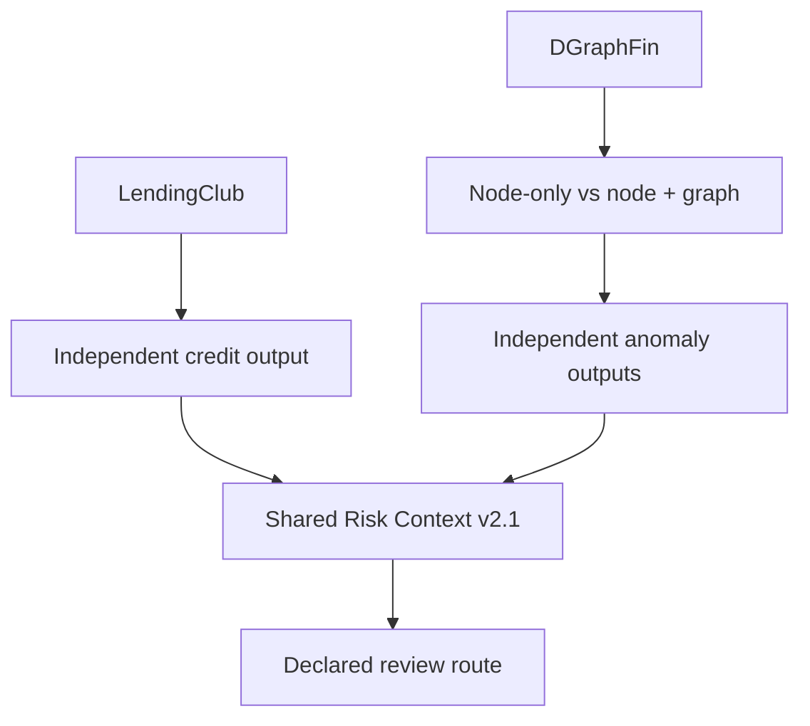

# Graph-Assisted Shared Risk Context

> **Điểm nổi bật:** Nghiên cứu tác động của đặc trưng đồ thị lên phát hiện mẫu rủi ro hiếm và chuẩn hóa đầu ra tín dụng, bất thường để hỗ trợ rà soát.
>
> **In one sentence:** Investigate how graph features affect rare-event detection, then standardize independent credit and anomaly outputs for review.

**Khóa luận tốt nghiệp AI · Trương Minh Hoàng · MSSV 25410008 · UIT, ĐHQG-HCM**  
Hướng dẫn: ThS. Phạm Thế Sơn

Tôi nghiên cứu hai câu hỏi: đặc trưng quan hệ có cải thiện xếp hạng bất thường trên đồ thị,
và làm sao đưa các đầu ra rủi ro độc lập vào cùng một quy trình xem xét mà vẫn giữ đúng
ý nghĩa, phạm vi thực thể và nguồn của từng đầu ra.

This individual undergraduate thesis combines a controlled graph-feature experiment
with a typed, traceable context-and-routing prototype. Its main lesson is that better
aggregate ranking can coexist with worse performance at a fixed review budget.

[Case study tiếng Việt / English](../graph-assisted-shared-risk-context-thesis.md) ·
[Kết quả và kiểm tra](RESULTS.md) · [Nguồn dữ liệu](DATA.md) · [Nguồn mã](PROVENANCE.md)

## Xem và chạy thử / Explore

| Thành phần | Nội dung |
| --- | --- |
| [Notebook RQ1](notebooks/01_graph_features_and_review_budget.ipynb) | Ví dụ đồ thị nhỏ có thể tính tay; hướng cạnh, cạnh trùng, nút cô lập; đọc kết quả AP và Top‑1% đã khóa |
| [Notebook RQ2](notebooks/02_shared_risk_context_routing.ipynb) | Adapter, kiểm tra ngữ nghĩa, 13 tình huống, định tuyến và 100 lần lặp với bản ghi tạo mẫu |
| [Mã chức năng](shared_risk_context/) | Hàm trích xuất từ notebook KLTN v2.1: graph features, đánh giá, context và routing |
| [Bốn notebook nghiên cứu](research/README.md) | Chuẩn bị dữ liệu → nguồn tín dụng → thí nghiệm DGraphFin → Shared Risk Context |
| [Bằng chứng kết quả gốc](evidence/historical/) | Bảng metrics, seed stability, kiểm tra tuân thủ và hash của các tệp kết quả đã lưu |
| [Kiểm thử](tests/test_thesis.py) | Hướng cạnh, trường hợp biên, tie handling, ngữ nghĩa và đối chiếu với bảng tình huống gốc |

## Bài toán và thiết kế / Research design

| Nhánh | Input → Output | Cách đánh giá |
| --- | --- | --- |
| RQ1 | DGraphFin node features + directed edges → anomaly ranking | Node-only LightGBM so với node + graph; AP, ROC-AUC, Top‑1%, seed stability và paired bootstrap |
| RQ2 | Các đầu ra LendingClub và DGraphFin độc lập → context có ngữ nghĩa và route đề xuất | Bảo toàn trường nguồn, tuân thủ hợp đồng v2.1, tình huống kiểm soát, tính xác định và bất biến thứ tự |



Hai bộ dữ liệu không có khóa định danh chung đã được xác minh. Tôi giữ riêng ngữ cảnh
tín dụng và bất thường; kịch bản nhiều ngữ cảnh là kiểm thử hệ thống có kiểm soát.

## Kết quả chính / Main results

Trên 183.840 nút test DGraphFin, cùng seed 42:

| Chỉ số | Node-only | Node + graph |
| --- | ---: | ---: |
| Average Precision | 0.025033 | 0.032505 |
| ROC-AUC | 0.712745 | 0.768485 |
| True positives trong Top‑1% (1.839 nút) | 62 | 55 |

AP tăng nhưng nhóm ưu tiên rà soát nhỏ nhất không cải thiện trong lần chạy này. Tôi
phân biệt đánh giá xếp hạng tổng thể với đánh giá theo công suất xử lý. Mã `A @ x`
dùng láng giềng đi ra; các phân tích tiếp theo cần xét hướng cạnh và xử lý đồng điểm.

Các chỉ số trên đã được **tính lại từ dự đoán gốc và đối chiếu hash** trong lượt chuẩn bị
portfolio. Đây là kiểm tra lại đầu ra đã lưu, chưa phải một lượt huấn luyện DGraphFin mới.
RQ2 được kiểm tra lại trên 195.420 đầu ra tín dụng và hai tập 183.840 đầu ra bất thường;
13 tình huống và kiểm tra lặp 100 lần đều đạt trong phạm vi hợp đồng đã khai báo.

## Chạy nhanh / Quick start

Từ thư mục gốc repository, dùng Python 3.12 trong môi trường riêng:

```bash
cd projects/graph-assisted-shared-risk-context
python -m pip install -r requirements.txt
python run_demo.py
python -m unittest discover -s tests -v
python run_notebooks.py
```

Demo và hai notebook nhỏ chạy bằng dữ liệu tạo mẫu hoặc bảng kết quả tổng hợp đi kèm;
không yêu cầu tài khoản, API key hoặc tải bộ dữ liệu lớn. Lệnh notebook mặc định ghi
bản chạy vào `executed/`; dùng `--in-place` để cập nhật output trong notebook nguồn.

Để kiểm tra các tệp dự đoán gốc đang có trên máy:

```bash
python -m pip install -r requirements-replay.txt
python replay_saved_outputs.py --artifacts /path/to/protocol_v2_1
```

Lệnh này xác minh hash đầu vào, ghép dự đoán–nhãn theo khóa trong từng bộ dữ liệu,
tính lại chỉ số và kiểm tra bảo toàn trường. Các Parquet theo từng bản ghi được giữ
ở nguồn dữ liệu/thực nghiệm riêng. Cách sinh lại chúng nằm trong [research](research/README.md).

## Điều tôi học được / What I learned

- Một cải thiện AP chưa trả lời đủ câu hỏi “với K vị trí rà soát thì tìm được bao nhiêu mẫu dương?”.
- Hướng cạnh, nút cô lập, cạnh trùng và đồng điểm cần được định nghĩa bằng mã có thể kiểm tra.
- Hai điểm số cùng nằm trong [0,1] vẫn có thể khác ngữ nghĩa và không thể cộng trực tiếp.
- Tái lập kết quả cần tách mô hình, dữ liệu, tham số, phiên bản và đầu ra đã lưu.

The public notebooks explain the mechanisms with small inputs; the research notebooks
retain the full experiment. [RESULTS.md](RESULTS.md) distinguishes saved experimental
results, current replay, unit checks and work that still needs a fresh training run.
