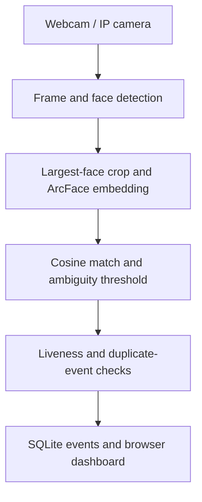

# Multi-Camera Face Attendance — System Design

**Source:** Final team report, Nam Sài Gòn, UIT, 2026. My assigned role: image processing, face detection/recognition, multi-face requirements and reducing false matches. This is a report-grounded design summary, not a newly tested implementation.

| Thành phần / Stage | Theo báo cáo / Reported behavior | Phần cần kiểm tra / Open validation |
| --- | --- | --- |
| Detection | YOLO; Haar fallback | Recall by lighting, pose and occlusion |
| Recognition | ArcFace normalized embedding; LBP fallback | FAR/FRR, unknown identities, threshold/margin |
| Liveness | ONNX main engine; heuristic fallback | Spoof tests; distinguish hard block and warning |
| Cameras | RTSP, MJPEG and reconnection | Concurrent cameras, backpressure, FPS/latency |
| Attendance | Duplicate-event suppression, typically 20 seconds in report | Concurrent requests and shift/day boundaries |
| Storage | Employee/profile/camera/log tables in SQLite | Access controls, retention and deletion |

## Reported interfaces

| Endpoint | Purpose |
| --- | --- |
| `GET /api/employees` | Employee list |
| `POST /api/employees/{id}/face-profiles` | Enrollment image |
| `GET /api/cameras` | Camera list |
| `POST /api/cameras/{id}/test` | RTSP connection check |
| `GET /api/cameras/{id}/stream` | MJPEG stream |
| `POST /api/attendance/recognize-image` | Recognition/liveness and optional log |
| `GET /api/attendance/logs` | Attendance history |
| `GET /api/attendance/dashboard-stats` | Dashboard summary |
| `GET /api/reports/daily.csv` | Daily aggregate export |
| `GET /api/reports/range.xlsx` | Date-range export |

Multiple cameras do not imply multiple faces per frame: the main reported crop selects the largest face. The MVP is PC/LAN; Raspberry Pi latency and INT8 performance require a separate hardware run. Full source and face-data processing were not rerun during this portfolio update.
